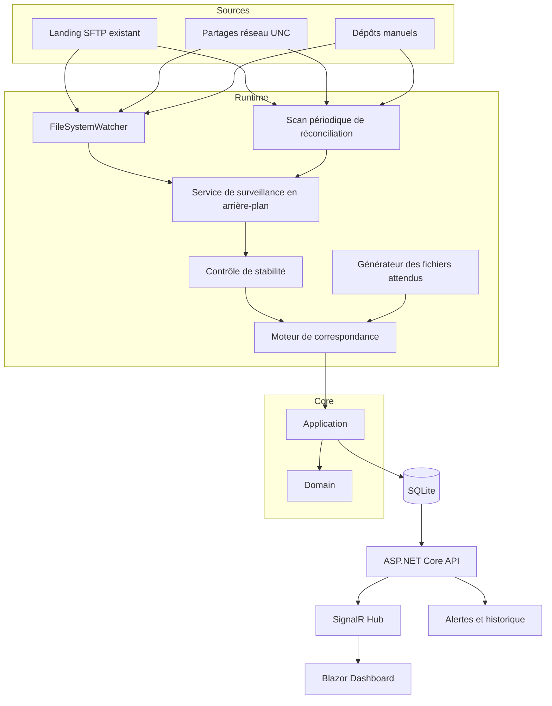

# Architecture technique

## Vue logique

## Projets

- **Domain** : entités, états, règles métier et invariants.
- **Application** : cas d'usage, interfaces, génération des attentes, matching et orchestration.
- **Infrastructure** : EF Core, accès fichiers, watcher, scan périodique, notifications et persistance.
- **Api** : endpoints, configuration, hébergement du worker et hub SignalR.
- **Web** : interface Blazor et tableau de bord.
- **UnitTests / IntegrationTests** : règles métier, moteur, persistance et scénarios de bout en bout.

## Cibles .NET et persistance SQLite

La solution conserve une seule base de code et cible `net8.0` et `net10.0` via `TargetFrameworks` défini dans `Directory.Build.props`. Tous les projets héritent de ces cibles afin que les références entre projets restent cohérentes.

- La cible .NET 8 utilise EF Core SQLite 8.x, Swashbuckle 6.x et ASP.NET Core MVC Testing 8.x.
- La cible .NET 10 utilise EF Core SQLite 10.x, Swashbuckle 10.x et ASP.NET Core MVC Testing 10.x.
- SQLite est le fournisseur de base de données dans les deux configurations ; aucun serveur SQL externe n'est requis.
- Un SDK .NET 10 peut compiler les deux cibles. Un environnement équipé uniquement du SDK .NET 8 doit limiter la propriété `TargetFrameworks` à `net8.0` lors de la restauration, de la compilation et des tests.

Cette sélection conditionnelle des packages évite de forcer des dépendances ASP.NET Core ou EF Core d'une génération sur l'autre.

## API REST et documentation

- Les endpoints HTTP sont regroupés sous `/api/monitoring-rules` et délèguent les opérations au `MonitoringRuleService`.
- Les contrats HTTP (`MonitoringRuleRequest` / `MonitoringRuleResponse`) isolent l'API des entités Domain.
- Swagger UI est exposé en environnement Development à `/swagger` ; le document OpenAPI est disponible à `/swagger/v1/swagger.json`.
- Les résumés/descriptions des endpoints et les commentaires XML des contrats alimentent la documentation OpenAPI. Le détail des routes et des payloads figure dans `docs/API.md`.

## Principes de fiabilité

1. Le watcher n'est jamais la seule source de vérité : un scan périodique rattrape les événements perdus.
2. Les événements sont idempotents : un même fichier détecté plusieurs fois ne crée pas plusieurs réceptions.
3. Un fichier n'est considéré reçu qu'après stabilité de sa taille et de sa date de modification pendant une durée configurable.
4. L'indisponibilité d'un dossier est un état explicite, distinct d'une absence de fichier.
5. Les attentes et incidents sont persistés ; le redémarrage de l'application ne réinitialise pas le suivi.
6. Les fichiers entrants sont observés en lecture seule.

## Flux de traitement

1. Générer les occurrences attendues à partir des règles et du calendrier.
2. Observer les créations/modifications et effectuer des scans de réconciliation.
3. Attendre la stabilité du fichier.
4. Normaliser le chemin, le nom, l'extension, la taille et les horodatages.
5. Associer le fichier à une attente selon les règles de correspondance.
6. Mettre à jour l'état, enregistrer l'événement et publier la mise à jour via SignalR.
7. Déclencher les alertes selon la politique configurée.

## Déploiement

Le moteur doit fonctionner indépendamment de l'interface utilisateur. Pour le développement, l'API héberge le BackgroundService. Une évolution possible sera un Worker Service séparé pour déployer la surveillance au plus près des répertoires.
